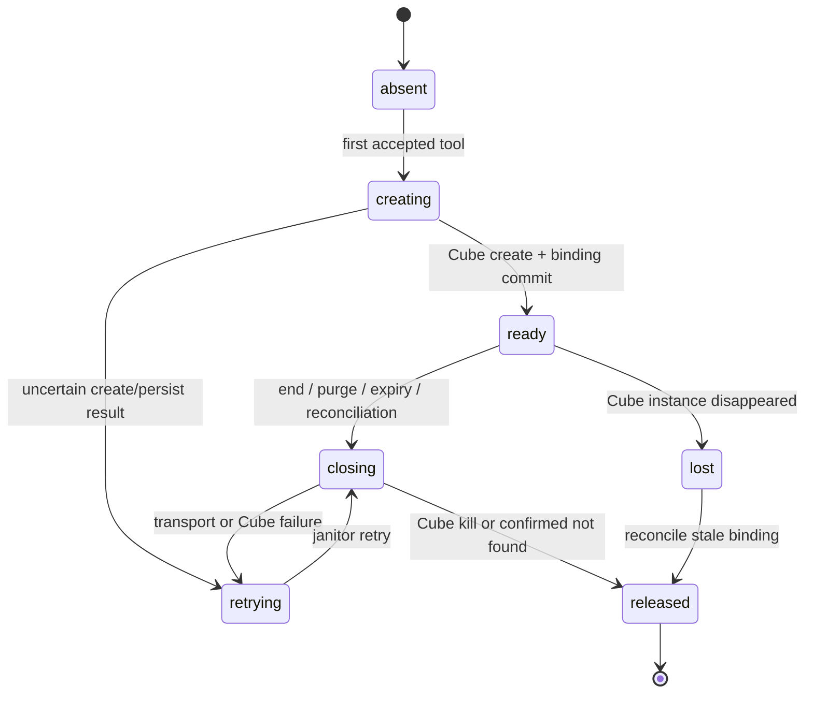

# Session Lifecycle and Client Experience Plan

Status: Proposed implementation plan

Date: 2026-11-09 (America/New_York)

## Current verified baseline

The single-node Cube development cluster and deployed manager can create, execute, transfer files, and close a session sandbox. A probe inside the deployed runtime Pod exercised all four tools through the manager, then closed the sandbox; CubeAPI showed zero active sandboxes. The runtime server's `SANDBOX_MANAGER_ADDR` is still unset, so browser and App users do not execute Cube tools.

The v1 session-manager owns `active` and `ended` records and purges transcripts. The backend currently ends the authoritative session first, then asks the in-memory runtime to end on a best-effort basis. Purge also asks the runtime on a best-effort basis before deleting the record. Runtime's v1 destroy callback asks Cube to close, but it cannot ensure delivery after a restart or network failure. The manager recovers live Cube IDs from Cube metadata on startup, but has no durable close intent or periodic comparison with session status. Cube's 30-minute TTL is the last cleanup bound, not a complete lifecycle.

The web console already has list/chat, rename, end, purge confirmation, transcript pagination, and tool activity rendering. The Expo App has the corresponding API methods and basic management/chat flows (see `managed-agents-mobile/doc/02-sessions.md` and `03-chat.md`). Both clients currently treat `active`/`ended` as the only user-visible session states; neither receives workspace cleanup status.

## Desired behavior and invariants

1. Session-manager remains authoritative for conversation status and ownership. `ended` is terminal: no new messages or tool calls are admitted. Purge removes the conversation and transcript but never erases an outstanding sandbox cleanup task.
2. Sandbox-manager alone owns Cube IDs, the Cube key, creation leases, close intents, retries, and orphan reconciliation. Neither client, backend, nor runtime stores a Cube ID.
3. Every Cube sandbox carries its platform session ID in Cube metadata. The manager's durable binding record and Cube's list API must reconcile after a crash. If creation succeeds but binding persistence fails, the manager attempts immediate kill and records an orphan for retry.
4. A `CloseSessionSandbox` request is idempotent. Closing waits for an in-flight tool under the session lease or cancels it before kill. A failed kill remains `closing` and is retried; it never becomes `ready` merely because one attempt failed.
5. A restart, deleted session, ended session, expired lease/TTL, duplicate create response, or lost Cube instance has an explicit resolution. The manager never recreates an empty workspace for a session whose previous workspace was lost without an explicit user-facing decision.
6. Only an `active` session can reserve a sandbox. The reservation and session-status check must be atomic against an end/purge operation, or creation must recheck status before publishing the binding and kill on conflict.
7. One deployment replica is the current pilot; durable compare-and-swap and a janitor are required before adding manager replicas or enabling general user traffic. The development decision to defer additional service authentication remains in [D004](decisions.md); it is not silently broadened by this plan.

## State model

Conversation and workspace are separate axes. The client does not infer one from the other.

| Axis | States | Owner | Meaning |
| --- | --- | --- | --- |
| Conversation | `active`, `ended`, absent after purge | session-manager | Whether chat may continue and whether the transcript exists. |
| Workspace | `absent`, `creating`, `ready`, `closing`, `released`, `lost`, `retrying` | sandbox-manager | Whether a Cube workspace is available or being reclaimed. |



`released` is a retained audit/tombstone state for a bounded retention period, not a live VM. The manager reports a coarse public workspace status; the Cube ID and error details remain internal.

## Durable data and transactions

Add a manager-owned `session_sandbox_bindings` table in the shared Supabase Postgres project, accessed through PostgREST with the service role and protected by RLS with no user policies. It must not cascade from `agent_sessions`: purge must preserve pending cleanup. Required fields: `session_id` primary key, `user_id`, `sandbox_id` nullable, `state`, `generation`, `profile_version`, `created_at`, `updated_at`, `expires_at`, `lease_until`, `close_requested_at`, `next_retry_at`, `attempts`, and bounded `last_error_code`. Put indexes on due closing/retry rows and expiry. No API keys, command text, or file contents belong in this table.

Use timestamped migrations and PostgREST RPCs backed by SQL transactions for reserve, bind, request-close, claim-retry, and finalize. Reserve checks `agent_sessions.status='active'` under a row lock; it must not read-max-write outside the database. A unique session key and generation fence allow one creator. The create call uses the session ID as Cube metadata; after Cube returns, bind checks the generation and conversation state. On a failed bind, kill and retain an orphan record if kill fails. The janitor scans due rows and Cube's active list, closes unknown or duplicate managed sandboxes, and reconstructs a missing binding only after verifying the owning session is still active. Preserve unmanaged Cube sandboxes.

The manager's PostgREST adapter has a memory implementation with the same state transitions for tests. All retry operations have a deadline, backoff with jitter, and an upper bound at the Cube TTL. Reconciliation records counters and structured logs without secrets. Keep the existing single-replica in-memory path behind a migration flag until the durable schema and backfill are verified.

## Lifecycle flows

| Trigger | Ordered actions | Failure/retry behavior |
| --- | --- | --- |
| First tool | Validate session ownership/status through the trusted service path; reserve; create Cube; bind; execute. | Timeout/unknown create result is reconciled by metadata before retry. Never create a second sandbox while a lease is live. |
| End | session-manager marks `ended`; backend requests manager close; runtime stops any live agent. | End remains successful if manager is unavailable. The durable binding remains due; janitor observes ended status and retries kill. |
| Purge | Backend verifies owner; request/retain close intent; session-manager deletes transcript and record; runtime evicts live agent. | Cleanup intent survives deletion. If close-request dispatch fails, janitor sees a binding whose session no longer exists. Purge result reflects transcript deletion, not immediate VM release. |
| Runtime TTL/restart | Runtime may evict in-memory state without ending the conversation; manager keeps the workspace until explicit close or its configured lifetime. | Runtime can reconnect to the same sandbox if still present. A lost sandbox is surfaced, never silently replaced. |
| Workspace expiry | Manager marks expired binding closing and kills Cube instance, even if conversation remains active. | Chat remains readable; the next tool receives an explicit workspace-expired error and a recovery action. |
| Manager restart | Load due bindings; reconcile with Cube list before serving `Ensure`. | If PostgREST or Cube is unavailable, fail readiness for new v3 creates while preserving v1/v2 service behavior; retry recovery. |
| Retention sweep | session-manager removes old ended records only after its end event or manager reconciliation has a durable close intent. | Manager's independent tombstone survives the sweep until cleanup is confirmed. |

For the pilot, a bounded workspace lifetime is preferable to an indefinite session lifetime. Define the exact lifetime in config and expose it in the UI once the policy is fixed. A 30-minute Cube TTL currently exists, but a user may return to an active conversation after it expires; the UI must explain why the old workspace cannot be resumed.

## API and service contract work

- Keep `sandbox.v3` backward compatible. Add only fields/RPCs needed for a coarse workspace status and an idempotent close request acknowledgement. Never return `sandbox_id` to runtime or HTTP clients.
- Backend wires an optional sandbox-manager client. It calls close after an authoritative end and before/after purge as specified above. The durable manager janitor is the reliability mechanism; the HTTP request is a latency optimization. The backend never trusts a client-supplied session ID without its existing owner check.
- Add `GET /api/sessions/:id/workspace` for the owner, returning `{state, expires_at?, retryable?, message?}`. It may use the existing `GetSessionSandboxStatus` RPC. Return 404 for non-owner/missing session; no Cube internals or infrastructure error strings. Do not add per-tool browser routes in this phase.
- Add typed error codes for `workspace_lost`, `workspace_expired`, `workspace_unavailable`, and `capacity_exhausted` on the existing tool result/error stream. Preserve `active`/`ended` and current session-list fields. Avoid promising immediate cleanup from an HTTP 204 end/purge response.
- Keep `SANDBOX_MANAGER_ADDR` absent in the deployed runtime until the durable lifecycle and UI copy pass their gates. A feature flag should scope the initial user cohort when enabling it.

## Web console design

The current React/Vite app keeps its chat rail, transcript, and session list. Add workspace information in the chat header and in a small details panel; do not make the session list a cluster operations dashboard.

```text
Desktop /chat/:id
┌─ Sessions ───────┬─ Agent name · Conversation active ─ Workspace ready ─┐
│ Search           │                                                       │
│ New chat         │  transcript + collapsible tool steps                │
│ active / ended   │                                                       │
│                 │  [workspace notice, only when expired/lost]          │
│                 ├───────────────────────────────────────────────────────┤
│                 │  composer / Stop stream                               │
└─────────────────┴───────────────────────────────────────────────────────┘
```

- Header shows `Starting workspace`, `Ready`, `Releasing`, `Expired`, or `Unavailable` only after a tool or status lookup makes it relevant. Show a spinner for creating/releasing; an ended conversation displays its read-only transcript and no composer. Tool activity stays in the transcript, with status, duration, and bounded output.
- End action confirms that chat stops and workspace release may finish shortly after. On success, disable composer immediately, refresh status, and keep transcript visible. Purge confirmation separately states that transcript deletion is irreversible and cleanup may continue in the background.
- If Cube is down, retain draft text, show a retryable notice, and never imply the tool ran. If the workspace is lost/expired, show a clear recovery choice (start a new chat with the same agent, optionally copy prompt); do not re-run tools automatically.
- Narrow browser widths use the existing session drawer. Status becomes a compact chip; action menus remain keyboard and touch accessible. Loading, empty, permission-denied, and stale-status states need distinct copy. Poll workspace status only while `creating`, `closing`, or `retrying`; stop when settled or when the view closes.

## Expo App design

Keep the existing Expo Router, Supabase session, and API client from mobile requirement 0004. The App consumes the same backend endpoints and state names as the web console; it never calls Cube or manager directly.

```text
Phone chat screen
┌─────────────────────────────┐
│ ‹ Chats   Agent       ⋯     │
│ Workspace: Ready            │
├─────────────────────────────┤
│ transcript                  │
│  tool step ▾ Bash · Done    │
│  output (expand/copy)       │
│                             │
├─────────────────────────────┤
│ message composer       Send │
└─────────────────────────────┘
```

- Put End, Rename, and Delete in the header overflow menu; use a native confirmation sheet for permanent deletion. The session list keeps active/ended filters and a small workspace badge only where useful. A bottom sheet explains workspace expiry or loss and offers `New chat with this agent`.
- Tool steps are collapsed by default on narrow screens, expandable with copyable bounded output. Preserve scroll position across streamed text, pagination, and app background/foreground transitions. A stopped or interrupted reply stays visibly partial and is not presented as saved.
- On app resume, refresh the session and workspace status; if a close is still pending, show `Releasing workspace` without blocking navigation. Offline mode shows cached transcript with a stale label and disables sending. Screen-reader labels, touch targets, Dynamic Type, safe-area insets, and keyboard avoidance are acceptance requirements.
- Reuse the current JWT, 401 sign-out behavior, and owner-scoped API. No new Expo package is required for the plan. Before implementation, follow the App repo's versioned Expo documentation rule for any native API change.

## Delivery order and exit gates

| Milestone | Repositories | Deliverable | Exit gate |
| --- | --- | --- | --- |
| L1. State and migration | `managed-agents-design`, `sandbox-manager` | Finalize state names, migration, SQL RPCs, memory adapter, backfill plan | Fresh and upgraded DB tests; RLS; concurrent reserve and end/purge race tests. |
| L2. Manager controller | `sandbox-manager` | Durable binding, close retry, orphan/duplicate reconciliation, startup recovery, metrics | Kill failure/outage/restart/TTL tests; two simultaneous first tools create one Cube VM; no orphan after reconciliation. |
| L3. Conversation hooks | `managed-agents-backend`, `session-manager`, `agent-runtime`, `protos` only if additive contract is needed | End/purge close dispatch, terminal admission, status endpoint and typed tool errors | Owner isolation, end-during-tool, purge-with-manager-down, runtime restart, retention sweep tests. |
| L4. Client design and implementation | `managed-agents-frontend`, `managed-agents-mobile` | Status, confirmations, expired/lost recovery, tool-step detail | Web build and responsive/keyboard checks; App lint/typecheck and device checks; both clients show identical backend state. |
| L5. Pilot enablement | manifests and operations | Non-root template, bounded cohort flag, runtime address, observability, rollback | Real chat and both clients: first tool → reuse → end/purge → zero Cube VMs; injected outage and rollback drill. |

Do not merge a schema-dependent service configuration before its migration is applied. Build each repository independently; release additive proto tags before consumer updates. Main-branch pushes deploy automatically, so deploy the state machinery behind disabled flags, verify, then enable a small cohort. Rollback first disables runtime tool admission, then lets the manager drain and reconcile pending cleanup; preserve binding rows and Cube metadata until no live or orphaned sandbox remains.

## Open decisions before L1 code

1. Workspace lifetime and post-expiry behavior: recommend a fixed maximum lifetime and a new-chat recovery action, with no silent recreation.
2. Whether owner-visible workspace status is needed on every session-list row or only in the open chat: recommend only the open chat to avoid N status RPCs per page.
3. Pilot cohort source: recommend existing `team_members` plus a server-side allow-list/feature flag, never a browser flag.
4. Manager's service identity and private route remain deferred under D004 for the development pilot; review before broader rollout.
